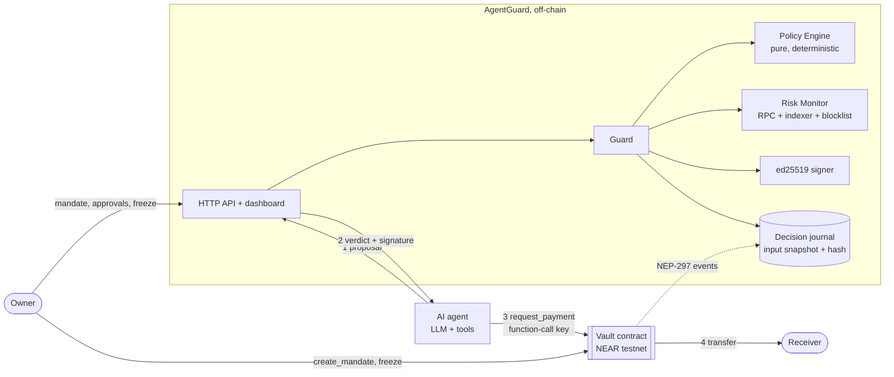

# Architecture

## Components

| Path | What it is | Verified here |
| --- | --- | --- |
| `packages/schema` | Shared types and dependency-free validators. Amounts are yocto strings, parsed with `BigInt`. | typecheck |
| `packages/policy-engine` | `evaluate(input) → verdict + rule hits`. Pure: no clock, no network, never reads `justification`. | 15 unit tests |
| `packages/risk` | Receiver facts (exists, contract, age, tx count, code change) → score 0–100; shared blocklist with mandatory evidence. | 5 unit tests |
| `packages/guard` | Orchestrates a check, signs `allow`, records decisions, handles owner approval, `replay()`. | 8 unit tests |
| `packages/vault-sim` | TypeScript mirror of the contract rules + a model of NEAR access-key rules. Used by the offline demo. | via scenarios |
| `packages/sdk` | `guardedPay()`: block → refuse, warn → wait for owner, allow → submit. HTTP and in-process clients, simulator executor. | via scenarios + API tests |
| `packages/near` | Testnet executor (near-api-js). | **not run here — verify after `pnpm i`** |
| `contracts/vault-core` | The vault rules in plain Rust, no dependencies. | 14 cargo tests |
| `contracts/vault` | near-sdk wrapper: caller, time, balance, `ed25519_verify`, transfers, events. | **not compiled here — run `cargo near build`** |
| `apps/api` | HTTP API (Node `http`, no framework), SSE event stream, serves the dashboard. | 9 HTTP tests |
| `apps/agent` | Tool-calling agent loop; OpenAI-compatible LLM, scripted and "gullible" models. | via scenarios |
| `apps/web` | Operator dashboard, vanilla JS. | screenshots |
| `attacks` | The 12 demo scenarios and `pnpm demo`. | 12 tests |

## One payment, step by step

1. The agent's LLM calls `propose_payment`. The **runtime** (not the model) fills `mandate_id` and `provenance` — whether the address came from the mandate, the user, a tool output or the model itself.
2. AgentGuard fetches receiver facts (async), then in **one synchronous step** reads policy, mandate, budget state (spent + live reservations), scores risk, evaluates, assigns a nonce, signs and stores the decision. Two concurrent proposals can never see the same remaining budget.
3. `allow` → the agent receives the authorization: `agentguard:v1|contract|mandate|receiver|amount|nonce|expires_at_ms|input_hash` and its ed25519 signature (valid 120 s).
4. The agent calls `request_payment` with its function-call key. The vault checks, in order: caller is the agent; not frozen; mandate exists, not revoked, not expired; authorization not expired; nonce unused; signature valid; receiver allowed; amount ≤ per-payment limit; committed + amount ≤ budget; balance. Then it commits the amount and schedules the transfer; a failed transfer releases it in the callback.
5. The agent reports the execution; the journal moves the amount from "reserved" to "spent".

## Why a separate vault instead of only OutLayer policies

[OutLayer Agent Custody](https://app.outlayer.ai/docs/agent-custody) already enforces limits, allow-lists and multisig inside a TEE, and AgentGuard is designed to sit in front of it as well. The vault adds three things the demo depends on: budgets scoped to a **task** rather than a wallet; **exact** cumulative accounting (OutLayer documents its daily/hourly caps as best-effort under concurrent requests); and a second, independent signer requirement so that neither a stolen agent key nor a stolen AgentGuard key is enough on its own.

## Message format compatibility

TypeScript (`packages/guard/src/signer.ts → authorizationMessage`) and Rust (`contracts/vault-core → authorization_message`) must produce identical bytes. `contracts/test-vectors.json` holds real signed vectors generated by `pnpm vectors`; the Rust tests rebuild every message from its fields and compare.
